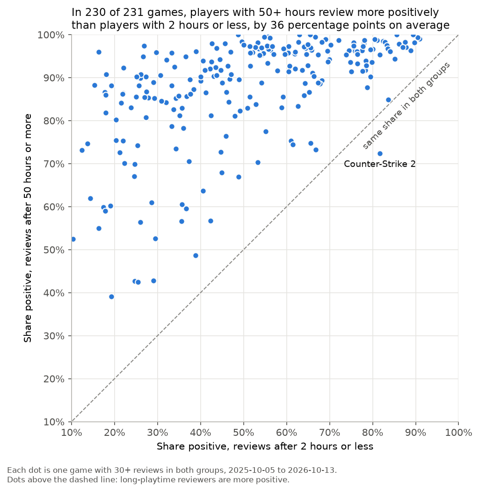
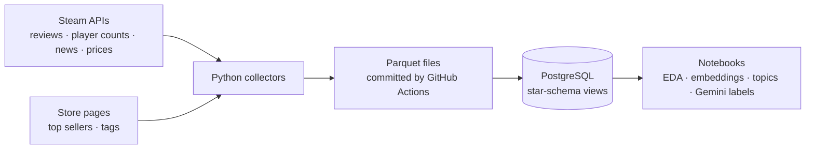

# Steam Player Feedback

**Which problems do Steam players complain about, and do game patches actually fix them?**

An automated pipeline that collects reviews, player counts, news posts and prices for 300 Steam games every day,
loads them into PostgreSQL, and analyzes them with statistics, embeddings and an LLM classifier.

Python · SQL (PostgreSQL + pgvector) · GitHub Actions · pandas · sentence-transformers · Gemini API · BeautifulSoup

## Results so far

- **Players who review early are far less positive.** Reviews written after 50+ hours are **36.5 points more
  positive** than reviews after 2 hours or less (95% CI 34.2–38.7), within the same game, in **230 of 231 games**.
  Refunds explain little of it (F1).
- **Sales bring more reviews, not better ones.** Sale days get **1.28×** as many reviews per day, with no change
  in the share positive (+0.2 points, CI −0.5 to +0.9) (F2).
- **Longer reviews are more negative.** Share positive falls from 94% for reviews under 20 characters to 69% for
  reviews over 1,000, lower in 265 of 272 games. Text analysis therefore over-represents complaints (F3).
- **The data matches Steam's own counts.** For the 53 games where every review should be collected, the total is
  within **0.04%** of Steam's. The check also exposed an Early Access quirk that changed how games are selected (C1).
- **An LLM finds patches a keyword rule misses.** On a 50-post test set labeled by hand before the prompt was
  written, Gemini agreed with the labels on **49/50**; the title/tag keyword rule on **40/50**, missing a quarter of
  real patches (D21, D22).



Every number above links back to a dated entry in [`decisions.md`](decisions.md): the decision log records
predictions written before results, what was measured, what went wrong, and known limitations.

## How it works



- **Game sample (D3, D11–D13):** 1,552 candidates from Steam's charts and 1,500 US top sellers (scraped with
  BeautifulSoup), filtered to games with at least one English review a day, then 300 drawn at random by size and
  genre with a logged seed. The list is frozen so the same games are compared before and after patches.
- **Scheduled collection (D5, D14, D15):** GitHub Actions runs pytest, collects, runs data checks and commits the
  data: reviews, news and prices daily; player counts every 4 hours. Reruns change nothing, and data Steam doesn't
  keep (player counts, prices) is saved even when part of a run fails.
- **Backfill (D16, D17):** a one-off year of history: 847,438 reviews and 7,381 news posts.
- **Database (D1, D18):** PostgreSQL 17 with pgvector in Docker. 914,844 reviews at the first full load, growing
  daily. Star-schema views (`fact_reviews`, `fact_prices`, `dim_game`, ...) sit on top of the raw tables.
- **Checks:** 150+ tests, and data checks after every run for duplicates, non-English reviews, bad timestamps and
  inconsistent prices.

## In progress

- **Complaint topics:** 741K reviews embedded with `all-MiniLM-L6-v2`; k-means clustering of 45K negative reviews
  produced a 22-topic codebook (D20, D23), with 200 hand-labeled reviews for testing an LLM topic labeler.
- **Patch labels:** Gemini labels for all official posts the keyword rule doesn't flag.
- **Next:** do patches change reviews and player counts? Before/after comparisons within each game, with sale days
  and Early Access exits handled separately.

## Repository

| Path | Contents |
| --- | --- |
| `collector/` | Steam API clients, parsers, collectors, backfill, database loader, embeddings |
| `checks/` | Data checks run after each collection |
| `sql/` | Schema, views, patch-rule views, sale calendar |
| `notebooks/` | API exploration, EDA, embeddings, patch and topic labeling |
| `prompts/` | Versioned Gemini prompts |
| `data/` | Daily Parquet files and hand labels (backfill and embeddings are gitignored) |
| `figures/` | Charts used in the decision log |
| `tests/` | pytest suite with scrubbed API fixtures |
| `decisions.md`, `metrics.md` | Decision log and metric definitions |

## Running it

```bash
pip install -r requirements.txt          # collectors and tests
pip install -r requirements-dev.txt      # notebooks, embeddings, Gemini
python -m pytest -q

# Postgres with pgvector on port 5433 (D1)
docker run -d --name steam-pg -p 5433:5432 -e POSTGRES_PASSWORD=<password> \
  -v steam_pgdata:/var/lib/postgresql/data pgvector/pgvector:pg17
psql "$DATABASE_URL" -f sql/schema.sql -f sql/steam_sales.sql -f sql/views.sql -f sql/patch_events.sql

python -m collector.reviews              # or players, news, prices
python -m collector.load                 # load new Parquet files; safe to rerun
```

`.env` holds `STEAM_API_KEY`, `GEMINI_API_KEY` and `DATABASE_URL`. The scheduled workflows need no secrets.

## Limitations

English reviews only (L2); games come from popularity charts, so trending games are over-represented (L3); 99 busy
games have less than a year of history because of the backfill cap (L5); player-count snapshots are irregular
because GitHub delays scheduled runs (L7). Findings are associations within games, not causal effects.

## Data and license

Reviews, news and prices come from Steam's public APIs and store pages, for non-commercial analysis. Reviewer
Steam IDs are dropped before storage (D7). The code is MIT licensed (see `LICENSE`); the license does not cover
Steam's data.
