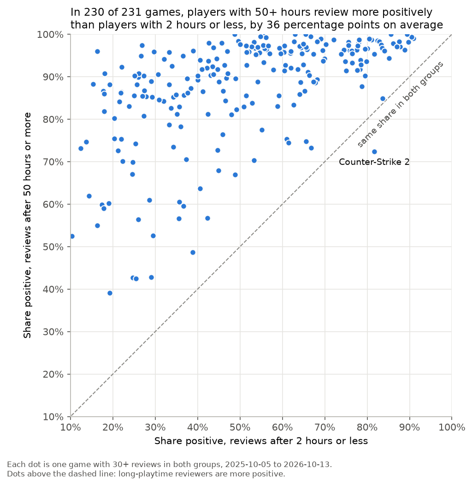
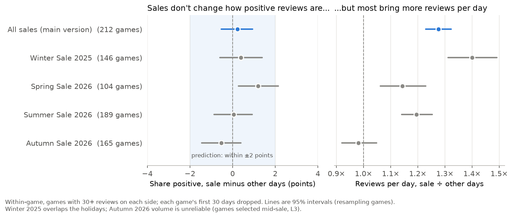
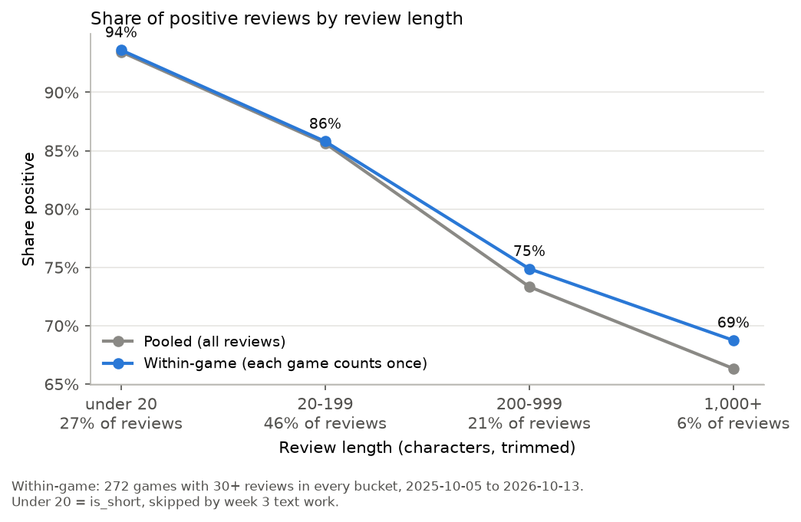

# Decision log

Each entry records what was decided, why, and what was rejected. Evidence for the 2026-10-04 entries is in `notebooks/01_explore_apis.ipynb`.

## Setup (2026-10-03)

### D1. Postgres runs in Docker
- **Decision:** `pgvector/pgvector:pg17` container on port 5433, data in the `steam_pgdata` volume.
- **Why:** pgvector (needed in week 5) is painful to compile on Windows; the Docker image ships with it.
- **Rejected:** reusing the existing Windows Postgres install.

### D2. Python 3.14
- **Decision:** the project venv uses Python 3.14.
- **Why:** it's the installed version, and everything used so far installs and runs on it.
- **Fallback:** if a week 3–5 library lacks 3.14 support, recreate `.venv` with Python 3.12.
- sentence-transformers and transformers installed cleanly on 3.14 (2026-10-03)

## Data collection (2026-10-04)

### D3. Candidate pool from charts and top sellers, filtered by English review rate
- **Problem:** GetAppList returns about 190k games. Checking each one at 1 call/sec would take more than 2 days, so don't scan the full list.
- **Decision:**
  1. **Candidates:** `ISteamChartsService/GetMostPlayedGames` (top 100 by players), the app IDs from `ISteamChartsService/GetTopReleasesPages` (monthly "top releases" lists), and the top 1,500 of the US store's top sellers (`store.steampowered.com/search/results/?filter=topsellers&category1=998&cc=us&infinite=1`, 15 pages of 100). The two charts alone gave only 183 apps, too few for 300. Snapshot taken 2026-10-05; pages are cached, so reruns reuse it. Bundle/package rows are skipped and counted.
     - **Why top sellers, US:** the store's "User Reviews" sort ranks by % positive weighted by volume, not by review count, so it would pull in small, well-liked games (checked 2026-10-05). Top sellers covers a broad range of sizes. `cc=us` matches D8, and global top sellers would add games sold mostly outside English-speaking markets that would fail the English review bar anyway.
  2. **Type check:** appdetails for each candidate; keep `type == "game"` and `release_date.coming_soon == false`; drop apps that return `success: false`.
  3. **English review rate:** one reviews call per candidate (`filter=1&languages[0]=english&purchase_type=1&num_per_page=100`). Rate = number of reviews ÷ days from the oldest of those 100 to now.
  4. **Threshold:** keep games with at least ~1 English review/day, then pick ~300 (see D11–D13).
- **Why the review rate:** it measures exactly what the analysis needs. `total_reviews` doesn't, because it's all-time and all-language, so it can't tell an old hit from a game people are reviewing in English today.
- **Rejected:** scanning all 190k games (too slow); filtering on `total_reviews` (wrong measure).
- top-releases chart only returned the Dec 2024–Feb 2025 lists, so it isn't contributing recent releases
- Action is 58% of survivors' main genre. That's fine, because the draw is proportional, and tags for the final 300 handle week 7's matching
- **Final funnel (run of 2026-10-06):**
  - **Candidates:** 1,552 after dedupe: 100 most played, 83 top releases, and 1,369 new from top sellers. Top sellers gave 1,482 app IDs, and 18 bundle/package rows were skipped.
  - **Type check:** 1,518 released games (34 dropped as not a released game).
  - **Rate bar:** 1,383 games at 1+ English review/day (135 dropped).
  - **Drawn:** 300. Sizes: 179 at 1–10/day, 82 at 10–100, 39 at 100+.
  - **Patches:** 188 of 300 (63%) had a patch detected in the last 6 months (unreliable, L4).

### D4. Review request parameters
- **Decision:** `filter=1`, `languages[0]=english`, `purchase_type=1`.
- **Why `filter=1`:** the default sort is "most helpful in the last 30 days", and `filter=recent` is silently ignored. Verified: `timestamp_created` goes down across all reviews and across pages.
- **Why `languages[0]=english`:** GetAppReviews is a protobuf service, so `language=english` and `languages=english` are silently ignored. English only looked filtered because it's the default; `languages[0]=schinese` proves the real filter works. Stray non-English reviews (seen: one Turkish review in HITMAN's English results) are skipped and counted; the parser raises only if they're over 10% of a page of 10+ reviews, which would mean the filter broke.
- **Why `purchase_type=1` (all):** the default `0` counts only reviews from Steam purchases. It hides 42% of CS2's English reviews and 100% of Marvel Rivals', so free-to-play games would be undercounted or missing. `steam_purchase` and `received_for_free` are stored so they can be filtered in the analysis.

### D5. Daily stopping rule: overlapping 72-hour windows
- **Decision:** each run pages every game back over the last 3 complete UTC days from `cursor=*` with the D4 parameters, passing back each response's `cursor`. Stop when any of these is true:
  - no `reviews` key comes back (end of stream; the key is missing, not an empty list)
  - the cursor comes back unchanged
  - a page's oldest review is older than the window start (keep only the in-window reviews from that page)
- **Output:** one file per complete UTC day, named by the date the reviews were created: `data/reviews/date=2026-10-07.parquet`. A day whose file already exists is skipped.
- **Why:** it needs no saved state. Each review lands in exactly one file, a rerun changes nothing, and a failed run is filled in by the next one, as long as successful runs are at most 2 days apart (one missed daily run is recovered; two in a row lose a day). Overlapping windows plus skipping existing files is a standard pattern.
- **Window:** `[today's UTC midnight − 3 days, today's UTC midnight)`, not "now − 72 hours", which would cut the first day in half and leave that half missing for good. Every day in the window gets a file, even an empty one, so a file existing means the day was collected.
- **Writes, all-or-nothing with a last chance:** a clean run writes every day. If any game failed (network error after retries, a broken page, or hitting the page cap), the newer days wait for a clean run, but the oldest day is written anyway without the failed games' rows, because it leaves the window after this run. The missing `(appid, day)` pairs go in the run summary (`data/reviews/_runs/`) and the run exits 1 so the Action emails. Without the last chance, one game that fails every run (a review bomb past the cap, say) would cost every game those days. A removed game (permanent error) is skipped and logged, not failed.
- **Why gaps are acceptable here:** reviews are historical. A missed (game, day) can be fetched later by paging further back, as a backfill would, so a gap is recoverable as long as it's recorded. Player counts are different: Steam only reports the current count, so a missed snapshot is gone forever (see D14).
- **Outages:** after 5 transient failures in a row, the run stops, writes nothing, and exits 1. One failed game mid-run doesn't trip it; a Steam outage does, instead of burning ~2.5 hours on retries. The workflow job also has `timeout-minutes: 90` as a backstop.
- **Safety:** at most 100 pages per game per run (CS2 needs ~42), so one review-bombed game can't stall the job.
- **Dedupe:** on `recommendationid` when saving, because reviews posted during a run can shift the page boundaries.
- **Changed from:** storing the newest `timestamp_created` already collected per game and stopping there (2026-10-04). That needed state the Action could find between runs.

### D6. Retry policy (`collector/steam_http.py`)
- **Decision:** retry only errors that can go away (timeouts, connection errors, 429, 5xx), with exponential backoff and at most 5 attempts.
- **Why:** a 404 / `result: 42` or a 400 is permanent. Retrying it wastes the 1 call/sec budget, so log it and move on.
- a cluster of 403s/429s means throttling; clear those cache files and rerun

### D7. Reviewer privacy
- **Decision:** `author.steamid` is dropped in the parser and never stored.
- **Test fixtures:** 3 reviews each, fake steamids (below the real SteamID64 range), text cut to 300 characters.

### D8. Prices
- **Decision:** `cc=us` everywhere, because prices differ by region. Daily prices use appdetails with many appids plus `filters=price_overview`, so 300 games take a handful of calls.
- **Free games:** in that mode they come back as `data: []`. Recorded as 0 cents with `is_free = true`, so "free" can't be confused with "price missing because the call failed".
- **But `data: []` isn't always free** (2026-10-15): see D19.

### D9. Patch detection
- **Decision:** official posts only (`feeds=steam_community_announcements`). A post is a patch if `"patchnotes" in tags`, OR the title contains patch/update/hotfix/bugfix, OR the title has a version number like 1.4.5.7.
- **Why not the tag alone:** it misses patches. Terraria tags none of its patches, and Valheim's "Patch 0.221.10" was untagged.
- **Known false positives:** the version pattern catches non-patches ("Terraria 1.4.5 - the Launch Date Revealed").
- **Week 2 follow-up:** measure each rule on 20 hand-checked posts; flag any game with zero tagged patches in a year.
- **Backfill:** page backwards with `enddate` until past 12 months. `enddate` is inclusive, so dedupe on `gid`.

### D10. Store page scraping
- **Age gate:** send cookies `birthtime=0; lastagecheckage=1-0-1990; wants_mature_content=1`. Without them, mature games redirect (302) to `/agecheck/app/<id>/`, which returns status 200 and can contain tag-like elements that would be wrong data. Even with the cookies, the run fails for that game unless the final URL's path starts with `/app/<id>/`. (A substring check missed `/agecheck/app/<id>/`; caught by a test on 2026-10-05.)
- **Tags:** taken from the `InitAppTagModal(...)` JSON (with vote counts), not the visible tag links.
- **Fail loudly:** this depends on Steam's page code, so `parse_tags` raises on zero tags and a test parses the saved HTML fixture. A redesign breaks the run instead of silently producing empty tags.

### D11. The game list is frozen
- **Decision:** select ~300 games once, before the first scheduled run; never add games later. Drops (delisted, reviews disabled) are logged with date and reason, and their earlier data is kept.
- **Why:** week 7 compares the same games before and after patches. A monthly refresh would move games in and out mid-study.
- **Rejected:** monthly refresh.
- Frozen 2026-10-06, seed 20261005, 300 games.

### D12. Patch activity is not used in selection
- **Decision:** the draw is grouped by size and main genre only. `patches_6mo` is recorded in games.csv for information.
- **Why:** title/tag patch detection (D9) is unreliable: 553 of 1,370 survivors (40%) showed zero patches in 6 months, including Rust, Overwatch and No Man's Sky, which name their updates ("LIVESTOCK", "COSMO", "Season 4") without patch keywords or tags. Grouping on a measure this noisy would control nothing.
- **Changed from:** targeting ~75–80% patch-active games (2026-10-04).
- **Follow-up:** better patch detection in weeks 2–3 (full post text, Gemini classification, possibly Steam's event categories); the patch-active share of the final 300 is measured then.

### D13. English review rate is a threshold, not a ranking
- **Decision:** keep candidates with ≥1 English review/day; group by size and main genre; draw randomly within groups with a fixed, logged seed. Cap the 100+/day group at ~40 games.
- **Why:** the 100-review rate can span hours for big games, so ranking on it would select for current spikes (review bombs, patch surges). As a low bar, that noise doesn't change who passes.
- **Rejected:** taking the top 300 by rate.
- **Validated (2026-10-08):** the rates measured at selection matched what was collected in the first 3 days: medians 3.2 vs 3.0 (1–10/day), 17.2 vs 15.0 (10–100), 131 vs 125 (100+). See R1.

### D14. Player counts every 4 hours keep partial snapshots
- **Decision:** each run, one `GetNumberOfCurrentPlayers` call per game, written to `data/players/hour=YYYY-MM-DDTHH.parquet` (`appid`, `player_count`, `fetched_at`). Whatever succeeded is written; failed and skipped games go in the run summary (`data/players/_runs/`). The run exits 1 only if most games failed, or after 5 transient failures in a row (the same outage breaker as D5). An hour whose file exists is skipped, so a rerun changes nothing. A removed or unknown game is skipped and logged.
- **Why not all-or-nothing like D5:** Steam only reports the current count. A missed snapshot can't be fetched later, so holding back 299 good counts because one game failed would lose them for good.
- **Schedule:** every 4 hours at minute 7 (`7 */4 * * *`). Each run costs ~6 Actions minutes (setup plus 300 calls), so this is ~1,200 minutes a month; with reviews (~500), ~1,700 of the 2,000 included in GitHub Free for private repos. The file names allow hourly runs, but hourly would be ~4,300 minutes a month. Confirm real usage in Settings → Billing after a few days.
- **Rejected:** all-or-nothing writes (loses data that can't be recovered); hourly runs (over the free minutes).

### D15. GitHub Actions setup
- **Decision:** two workflows (`reviews.yml` daily at 10:17 UTC, `players.yml` every 4 hours at minute 7), each: install pinned requirements, run pytest, collect, check, commit the data. Both share one `concurrency` group so they never push at the same time.
- **Commit even after a failure:** the check and commit steps run unless the job was cancelled (`!cancelled()`). A failed reviews run still writes its last-chance day and run summary, and a partial player snapshot can't be fetched again, so the data is saved first and the job is still marked failed, which sends an email.
- **No secrets needed:** reviews and player counts don't use the Steam API key.
- **Requirements:** `requirements.txt` pins only what the collectors and tests import. A full `pip freeze` on Windows includes Windows-only packages (e.g. `pywin32`) that fail to install on the Linux runner; notebook packages are in `requirements-dev.txt`.
- **Setup gotcha (2026-10-08):** the first push failed with exit code 128 because the repo let workflows only read. Fix: Settings → Actions → General → Workflow permissions → Read and write.

### D16. One-off review backfill (2026-10-10)
- **Decision:** `python -m collector.backfill`, run locally once. For each game, `fetch_window` over `[2025-10-05 00:00 UTC, 2026-10-05 00:00 UTC)`, both ends fixed so every game and every resumed run covers the same year, with at most 50 pages (5,000 reviews). It ends exactly where the Action's first file (`date=2026-10-05`) begins, so the two sets never overlap. Same D4 parameters and schema as the daily files.
- **Output:** one file per game, `data/backfill/reviews/appid=<id>.parquet` (gitignored), written with `storage.write_parquet`. A game whose file exists is skipped, so the run is resumable: after a crash, rerunning continues with the next game. A game with no reviews in the year still gets an empty file.
- **Cap counted from Oct 5, not from today:** `fetch_window` normally pages from the newest review, so the pages needed to get back to Oct 5 would come out of the 50. CS2 (~1,000/day) would spend ~60 pages on that and backfill nothing. So `cursor_at` first pages forward to the page that crosses Oct 5 (at most 100 pages, otherwise the game fails), and `fetch_window` starts from that cursor. This costs one extra call per game. The pages newer than Oct 5 grow by ~10 a day for CS2 (~60 on Oct 10), so rerun before ~Oct 14, or raise `SKIP_PAGES`.
- **Hitting the cap is fine:** unlike D5, a capped game is written, not failed. For busy games, 5,000 reviews reaches back only weeks or months (Half-Life 2, ~34/day: back to 2026-04-20).
- **How far back each game goes:** `data/backfill/reviews/_summary.json`, one entry per appid: `pages`, `rows`, `skipped`, `capped`, `earliest` (date of the oldest review fetched) and `complete_from` (the first day with every review). For an uncapped game, `complete_from` is the start of the year. A capped game stopped partway through its earliest day, so its `complete_from` is the day after `earliest`. Analyses that count reviews per day must start each game at its `complete_from`. Removed games and failures get an `error` entry and no file.
- **Failures:** the same rules as `reviews.collect`. A transient failure or broken page means no file for that game and the run exits 1, so a rerun retries it. A permanent error is logged and skipped. After 5 transient failures in a row, the run stops. Each game's summary entry is saved before its parquet file, so a crash can leave an entry without a file (refetched and overwritten by the rerun), never a file without an entry.
- **Results (2026-10-10):** 300 of 300 games, 847,438 reviews, 8,750 pages in ~3 hours, zero errors. 99 games hit the 5,000-review cap (see L5); coverage is in the `review_coverage` table.

### D17. News collection with full post text
- **Decision:** official announcements only (`feeds=steam_community_announcements`), with full post bodies (no `maxlength`). Backfill: every post from 2025-10-05, one file per game (`data/backfill/news/appid=<id>.parquet`), resumable. Daily: each run fetches the last 7 days and writes `data/news/fetched=YYYY-MM-DD.parquet`; the overlap means a late or missed run never loses a post, and the loader dedupes on `gid`.
- **No `is_patch` column:** the patch rule (D9) is still being measured, so it's applied in SQL or a notebook, where changing it doesn't mean refetching.
- **`gid` is stored as text:** Steam's post IDs are unsigned 64-bit numbers and can exceed Postgres `bigint`.
- **Failure handling like players (D14), not reviews (D5):** write whatever succeeded; exit 1 only if most games failed or the breaker trips. Posts stay fetchable for days, so partial files are safe.
- **Results (2026-10-13):** 7,381 posts from 265 games (~28 per game per year among games that post).

### D19. Daily price snapshots (2026-10-15)
- **Call:** `store.steampowered.com/api/appdetails?appids=1,2,3,...&cc=us&filters=price_overview`, 100 appids per call, so 3 calls for 300 games. Batching only works with `filters=price_overview`. Checked 2026-10-15: all 100 appids came back in each of the 3 batches. An appid missing from a response means the batch is too big; it counts as failed.
- **Four outcomes,** stored in `status`:

  | Response | `status` | Prices | `is_free` |
  | --- | --- | --- | --- |
  | `price_overview` | `priced` | `initial`, `final`, `discount_percent` (already cents) | false |
  | `data: []`, and `is_free` | `free` | 0 (D8) | true |
  | `data: []`, not `is_free` | `no_price` | NULL | false |
  | `success: false` | `not_found` | NULL, not 0 | NULL |

- **Why `no_price` exists:** cross-checking the 23 `data: []` games against appdetails, 22 are free-to-play. Call of Duty (1938090) is not free: it's the series hub, sold only as 10 edition packages, so it has no single price. Calling it free would be wrong, so each `data: []` game gets one full appdetails call (no filter) per run to read `is_free`, ~23 extra calls. A static list would go stale if a game changes.
- **Currency:** every price must be USD. Anything else means `cc=us` silently failed, so the run raises and writes nothing rather than mix currencies.
- **Storage:** like the other collectors. One file per UTC day, `data/prices/date=YYYY-MM-DD.parquet`, skipped if it exists, written atomically, with `fetched_at` per row. Run summary in `data/prices/_runs/` with counts per status and the `not_found`, `no_price` and failed appids. Loaded into `price_snapshots` (primary key `appid, snapshot_date`); `fact_prices` gives dollars and `is_discounted`.
- **Failures:** like players (D14). Today's price can't be fetched later, so whatever succeeded is written. Unlike players, any failed game makes the run exit 1: with only 3 calls, one failure is a whole batch. The step runs even if reviews or news failed.
- **A partial day stays partial:** if a batch fails, that day's file is written without those games, and a rerun the same day sees the file and skips. Those games have no price that day. Same tradeoff as players (D14): refilling would mean merging into an existing file, which breaks skip-if-exists; the gap is in the run summary's `failed`.
- **Timing:** the snapshot is usually taken before the 10 a.m. Pacific sale start, but not always. Compare `fetched_at` with the sale's start time, never `snapshot_date`.
  - The job is scheduled for 10:17 UTC (3:17 a.m. Pacific), and runs start up to 5–7 hours late (R2). Sales start at 10 a.m. Pacific: 17:00 UTC in summer time, 18:00 UTC in winter.
  - An on-time run misses a sale's first day; it shows up in the next day's snapshot. A run 7 hours late (17:17 UTC) in summer time lands just after the start and catches it. In winter, even that run is before 18:00 UTC.
  - So whether a snapshot on a sale's first day is discounted depends on how late the run was, and `snapshot_date` can't tell. The start as a timestamp: `(start_date + time '10:00') AT TIME ZONE 'America/Los_Angeles'` (`steam_sales` stores dates only). The same applies to the last day, which ends at 10 a.m. Pacific.
  - Fine for week 7, which works in days around a patch, as long as sale-day flags from prices use `fetched_at`.
- **Data check** (`checks/prices.py`, after the reviews check): fails on final above initial, a discount outside 0–100 or more than 1 point off `round(100 × (1 − final/initial))`, a priced row missing a price or at 0 cents, a free row with a nonzero price, a price on a no_price/not_found row, duplicate appids, more than 5 games without a row (~295 of 300), or more than 5 not_found. Today's real snapshot passes; the discount rule matched all 277 priced rows exactly.
- **First run:** 277 priced (53 discounted), 22 free, 1 no_price, 0 not_found (test run 2026-10-15, not kept; the first kept file comes from the Action).

### D20. Review embeddings (2026-10-15)
- **Model:** `sentence-transformers/all-MiniLM-L6-v2`, the standard baseline: fast on a CPU, 384 dimensions, good enough for clustering and retrieval. `normalize_embeddings=True`, so every vector has length 1, cosine similarity is a plain dot product, and pgvector's cosine distance works later.
- **Which reviews:** every review with `NOT is_short` (D18), from `reviews`: 701,330 on 2026-10-15. Coverage, dates and the rest are filtered at analysis time, not here, so one set of vectors serves every analysis.
- **BBCode is stripped before embedding:** `clean_for_embedding` removes Steam's tags (`[h1]`, `[b]`, `[spoiler]`, `[url=...]`, `[list]`/`[*]`, ...) and keeps the text inside them. Tags cost tokens and add noise. The tags are matched by name, so bracketed text that isn't a tag (`[10/10]`, `[x]`) stays. 9,483 non-short reviews (1.4%) contain tags. The database keeps the original text; only the model sees the cleaned version.
- **Truncation:** the model reads at most 256 tokens and silently ignores the rest, so the longest reviews are embedded from their opening only.
  - **Prediction (written before querying):** about 8% of non-short reviews are over 1,000 characters. Not blind: the week 2 length-by-playtime table showed the 1,000+ bucket at 4.6–6.7% of all reviews, and ~73% of reviews are non-short.
  - **Result:** **7.8%** (54,468 of 701,330). Counting real tokens on a random sample of 20,000 (cleaned text, with special tokens): **6.6% exceed 256 tokens**, and almost all of them are over 1,000 characters too. At ~4.2 characters per token, the real cutoff is closer to 1,080 characters. The median over-limit review has 406 tokens, so the model sees about its first 60%.
  - **It hits the most negative slice (F3):** reviews over 1,000 characters are 66% positive, vs 82% for the other non-short reviews.
  - **Accepted for clustering:** a review's opening usually states its main complaint. Week 5's RAG splits long reviews into chunks, which is the proper fix.
- **Never mix two models' vectors:** vectors from different models or settings live in different spaces, and comparing them gives meaningless results with no error. `data/embeddings/_meta.json` records model, `max_seq_length` and `normalize`. A run whose settings differ raises before writing anything.
- **Resuming by ID, not chunk number:** new reviews arrive daily, so a list position would stop meaning anything. Each run:
  1. reads only `recommendationid` from the existing part files;
  2. streams non-short reviews with a server-side cursor, 10,000 at a time, so it never holds all the texts;
  3. skips the IDs already done and embeds the rest, 10,000 per `part-<first id>.parquet`, written atomically.

  An interrupted run continues, a rerun after new reviews embeds only those, and a rerun with nothing new does nothing. A part file's first ID can't collide with an existing part, because every existing part's first ID is already done.
- **Storage:** `recommendationid` int64 and `embedding` as 384 float32 values (`fixed_size_list`). float32 rather than float64 halves the size, to about 1.1 GB. `data/embeddings/` is gitignored: too big for the repo, and rebuildable from the database.
- **Kept out of CI:** `sentence_transformers` (torch, gigabytes) is imported inside `main()` only and listed in `requirements-dev.txt`. Tests pass `embed_new` a fake `encode` that returns random unit vectors, so they run in seconds without the 90 MB model.
- **Cost:** 37 reviews a second on the laptop CPU (smoke run of 3,000), so the first full run takes **about 5 hours**. Daily top-ups are ~2,000 reviews, about a minute.
Don’t run the loader during an embedding run.
- **Checked (2026-10-22):** after loading through 2026-10-21, 741,200 of 741,200 non-short reviews are embedded (75 part
  files), all unit length. Nearest neighbours of a crash review, within one 10,000-review part file: the top 5 are all
  about crashes (similarity 0.60–0.70), vs 0.20 on average for random reviews.

- **Neighbour check (2026-10-23):** 50,000 reviews from 5 random part files, top 10 per query. Queries picked by keyword weren't always about that topic (the "refund" query was about co-op kicks; the first "matchmaking" query mixed crashes and matchmaking), and neighbours followed each review's main complaint. With single-topic queries:
crash 8/10 on topic (0 same game), matchmaking 10/10 (2 same game); top-10 similarity A–B vs ~0.20 for random reviews. Refund stays mixed for any pick: it's an outcome that follows many complaints, not a complaint, so it isn't a week 3 topic (possible separate flag). One vector per review means clustering gives one topic per review;
topics are labeled separately, several per review allowed (D23).

### D21. Measuring the patch rule (2026-10-16)
- **The rule lives in views, not a table:** `news_patch_flags` (one row per post, one column per rule: `rule_tag`, `rule_keyword`, `rule_version`) and `patch_events` (posts any rule flags), in `sql/patch_events.sql`. The rule will change in week 3; a view always reflects the current one, with no rebuild.
- **SQL and Python must agree:** the rule exists twice, as `is_patch` (`collector/parse.py`) and as the views. `notebooks/04_patch_events.ipynb` checks them against each other: they agree on all 7,482 posts. Postgres regexes use `\y` for a word boundary (`\b` is backspace there), and `rule_version` uses `~*` because Python compiles the whole pattern with `re.I`.
- **Official posts only:** all 7,482 posts are `steam_community_announcements`, so the title rule (D9) isn't seeing press articles.
- **Flagged:** 3,026 of 7,482 posts (40%). By rule, overlapping: tag 1,757, keyword 2,550, version 1,251.
- **Hand-check sample:** four groups, each defined by the first rule that fires, so every post is in exactly one and dropping a rule shows exactly what is lost:
Patch = the post announces changes that are now live in the game players are playing.
Beta or test-branch patches and DLC releases are both labeled a 0.

  | Group | Posts | Measures |
  | --- | --- | --- |
  | `tag` | 1,757 | the tag rule's precision |
  | `keyword_no_tag` | 1,163 | the precision of what the keyword rule adds |
  | `version_only` | 106 | the precision of what the version rule adds |
  | `none` | 4,456 | the misses |

  10 posts per group, at most one per game (so one prolific developer can't fill a group), ordered by `md5(gid)`, so the sample is the same on every run. Labeled blind: `data/labels/patch_posts_to_label.csv` is shuffled and has no group; the key is `data/labels/patch_sample_key.csv`. Overall precision weights each group by its size, not a plain average of four equal samples.
- **`version_only` barely matters:** 106 posts (1.4%). Even at poor precision it adds few wrong events, so keeping or dropping it hardly changes week 7. About 21 of the 106 contain dotted dates ("Extension of server maintenance [23.09.2026]"), the known false positive.
- **Recall is rough:** `none` is 60% of posts and only 10 of them are checked. If 1 of the 10 is a real patch, the Wilson interval puts the misses at about 80 to 1,800 posts. The recall range uses only `none`'s interval and ignores uncertainty in the flagged groups' precision, so it's a rough figure, reported as a wide range rather than fixed with more hand samples now.
- **Plan (week 3):** Gemini labels all 4,456 unflagged posts, which measures the misses directly; these 40 hand labels become the check on Gemini.
- **Known gap, not fixed before measuring:** the keyword rule matches whole words only, so "Patches", "Updates & Fixes", "Hotfixes" and "Updated" don't match (in Python too, so parity still holds). If the `none` group turns up such titles, widen it (e.g. `patch(es)?|updat(e|es|ed)|hotfix(es)?`), re-measure, and record both versions here.
- **What counts as a patch (2026-10-22):** a post announcing at least one change that is now live in the game players
  are playing, whether or not players notice it, and whatever it's called (patch, update, hotfix, season). Judged from
  the post body, not the title.
  - **1:** bug fixes, balance, content updates and seasons, in-game events the developers switched on, server-side
    changes, security/engine fixes, Early Access builds, leaving Early Access (noted "1.0"). A status roundup counts if
    it reports one deployed fix.
  - **0:** roadmaps and "coming soon", a new game's launch, demos and pre-release posts, test servers and beta branches,
    maintenance notices, sales, streams, community events and showcases, recaps of an update that has its own post.
- **Results:**

  | Group | Patches | Rate (95% Wilson) | Posts |
  | --- | --- | --- | --- |
  | `tag` | 9/10 | 90% (60–98%) | 1,757 |
  | `keyword_no_tag` | 7/10 | 70% (40–89%) | 1,163 |
  | `version_only` | 6/10 | 60% (31–83%) | 106 |
  | `none` | 2/10 | 20% (6–51%) | 4,456 |

  - **Sizes are live counts:** the notebook weights by current post counts, so estimates drift as posts arrive. After
    the 2026-10-22 reload (7,620 posts): 909 estimated misses of 4,545 unflagged; precision and recall unchanged.

  - **Overall precision 81%**, weighted by group size.
  - **About 890 missed patches** among the 4,456 unflagged posts, so **recall about 73%** (rough range 52–91%).
  - **Recall is a first estimate only:** each `none` label stands for ~446 posts. Reviewing 6 labels against the
    definition moved recall from 67% to 73%; one `none` label accounted for most of that.
- **Where the rule goes wrong:**
  - `tag` is reliable. Its one 0 is a real patch for a separate demo app.
  - `keyword_no_tag` adds real patches, but "update" also matches demos, closed betas and "Community Update" newsletters.
  - `version_only` is a coin flip on 106 posts (~50 false events), small enough to keep or drop.
  - The 2 misses in `none` name no patch: an in-game event going live after maintenance, and an anniversary event.
- **Follow-ups:**
  - **Week 3:** Gemini labels all 4,456 unflagged posts, checked against these 40. The prompt includes hard negatives
    (FC 27 closed-beta notes, demo updates, a mod.io map showcase). Test excluding titles with demo / beta / test
    server / community update against these labels. Add a patch type (bugfix, balance, content, technical, server-side).
  - **Week 7:** merge a game's patch posts within a few days into one patch episode. Beta-branch posts give an early
    date for some patches. The Oct 2025 Unity security patches are a negative control (patches that shouldn't change
    reviews).
  - **Added 2026-10-23 (test-set labeling):** open beta = 1 if the whole game is the open beta (the live game), 0 if
    it's an opt-in branch. Same-day or next-day scheduled updates that list their changes = 1 (many games post only
    once per update; the date error is under a day); further-out schedules and maintenance-only notices = 0. Free
    DLC released to every owner = 1 (content); paid DLC and free DLC previews = 0 unless the base game also changes.
  - **Updated 2026-10-23:** Ashenfall (`version_only`) relabeled 1 under the same-day rule. With the test set's 30
    unflagged posts (5 patches, D22), the unflagged patch rate is 7 of 40 (17%, 95% interval 9–32%). With current
    group sizes (7,620 posts): precision 81%, about 795 missed patches of 4,545 unflagged, **recall about 76% (range
    63–86%)**, up from the week-2 estimate of 73% (52–91%).

### D22. Patch labels from Gemini (2026-10-23)
- **Setup:** `gemini-3.8-flash`, temperature 0, prompt `prompts/patch_v1.txt` (the D21 rules plus 6 examples from the
  development set), structured JSON output (reason, is_patch, patch_type). Free tier: 5 requests/minute and 20/day,
  so 20 posts per call (`BATCH = 20`, used for development, test and full runs alike). Answers cached per prompt
  and model in `data/gemini/`.
- **Development set (34 of the 40 week-2 posts, excluding the 6 used as examples):** 32/34. One disagreement was a
  week-2 label made before the same-day rule existed (Ashenfall, relabeled 1); the other (Sky's anniversary) is
  genuinely ambiguous and was left alone rather than tuning the prompt to one post: 33/34. v1 frozen.
- **Test set (50 posts, labeled and committed before the prompt was written):** Gemini agreed with 45/50 as labeled;
  the D9 rule with 35/50. All 5 disagreements were hand-label errors under the written rules (3 rules were added
  during labeling and earlier labels weren't rechecked); corrected, Gemini 50/50 and the rule 34/50 (precision 15/20,
  recall 15/20). Only disagreements were re-reviewed, so 50/50 is an upper bound and 45/50 a lower bound.
- **Next:** label the 1,187 posts from L4's 99 untagged games first, then all unflagged posts (~228 calls, ~12 days).
  A consistency pass over every note mentioning beta, scheduling, DLC, events, demos or tests (9 posts) found no
  further labels breaking a rule.   Routine weekly event rotations (e.g. Forza's Festival Playlist) count as patches under D21 but are minor; patch types don't separate them yet. Week 7 may need an "event" type in a future prompt version.

## Metrics (2026-10-13)

### D18. Very short reviews are flagged, not dropped
- **Decision:** a review is short when it has fewer than 20 characters after trimming spaces, tabs and newlines: `reviews.is_short`, a generated column (`length(btrim(review, E' \t\r\n')) < 20`). Short reviews count in every rating metric (volume, share positive, playtime groups). Week 3's text work skips them with `WHERE NOT is_short`.
- **Why keep them for ratings:** the thumbs-up or thumbs-down is a full rating whatever the text length. They're also a large and different slice: 27.2% of all reviews are short, and 93.5% of them are positive vs 80.7% of longer ones. Dropping them would pull share positive down by about 3–4 points and change which games look well liked.
- **Why skip them for text:** under 20 characters there's no topic to extract. Typical examples: "great game 10/10", "best aim trainer", "Highly recommend!", "movement is so bad". The last one shows the cutoff also drops a few real complaints. That's accepted, since text work needs enough text to classify.
- **Why 20:** under 10 characters keeps only one-word reviews (15.9% of all reviews), which leaves "great game 10/10" in the text set. Under 50 characters (45.1%) would drop short but complete sentences that name a specific problem.
- **Generated, not computed in the loader:** it can't drift from `review`, and changing the rule needs no reload.
- **Changing it on a database that already holds data:** `CREATE TABLE IF NOT EXISTS` does nothing to an existing table, so the column is added by a separate `ALTER TABLE ... ADD COLUMN IF NOT EXISTS` in `schema.sql`, which fills all existing rows. A later rule change needs `ALTER COLUMN is_short SET EXPRESSION` (Postgres 17+), since `ADD COLUMN IF NOT EXISTS` skips a column that's already there. That's how the trim was fixed on 2026-10-13: plain `btrim(review)` trims only spaces, and many reviews end in newlines. The fix flagged 1,123 more reviews as short (251,231 → 252,354).
- **Other metric decisions** (UTC half-open periods, `complete_from` coverage for every metric, a 30-review minimum for any share, per-day over covered days) are in `metrics.md`.

## Estimates (2026-10-04)

### E1. English reviews per day for a typical game
- **Estimate:** about 30–40 per day, so 1 page per game on most days.
- **Evidence:** across the top 100 most-played games, using the page-1 rate (newest 100 English reviews, all purchase types): median 77/day; ranks 51–100 median ~39/day; max ~1,170/day. A 300-game list goes deeper than the top 100, so the typical game will be at or below the ranks 51–100 figure. Stardew Valley gets ~96/day; CS2 ~1,050/day (about 11 pages).
- **Daily run cost:** ~300 games × 1–2 pages plus a few heavy hitters ≈ 500–700 calls ≈ 10–12 minutes at 1 call/sec.

- **Actual (first run, 2026-10-08):** median **3/day** in the 1–10 group, 15/day in 10–100, 125/day in 100+. The estimate was ~10× too high for a typical game because it came from the top 100 most-played games, and the frozen sample goes much deeper (179 of the 300 games get under 10/day).
- **Actual run cost:** 625 calls (~11 minutes) for the full 3-day window; the busiest game used 59 pages.

## Results

### R1. First collection run (2026-10-08, manual)
| Check | Result |
| --- | --- |
| Reviews collected | 33,956 for Oct 5–7 (11,820 / 11,663 / 10,473 per day) |
| Games with reviews | 296 of 300 (the 4 without are in the 1–10/day group; zero reviews in 3 days is expected by chance for games near 1/day) |
| Duplicate review IDs / non-English reviews | 0 / 0 |
| Failed or missing games | none; all 3 day files written |
| Most pages for one game | 59 of the 100-page cap (~40% headroom) |
| Player counts | 300 of 300 games, no zeros |
| Developer replies | 0.4% of reviews have a `developer_response` |
| Share positive | 78.5% of reviews are thumbs-up |

### R2. Week 1 complete (2026-10-11)
- **Scheduled runs:** reviews ran on 2026-10-09 and 2026-10-10 with no failed or missing games (started 5–7 hours late; see D15). Player counts: 12 runs since 2026-10-08, every one with all 300 games.
- **Database:** 914,844 reviews (847,438 backfill + 67,406 daily) for all 300 games, from 2025-10-05 to 2026-10-10, with no gap or overlap between backfill and daily; 3,600 player snapshots; 318 Parquet files loaded.
- **Rerun check:** a second `python -m collector.load` loaded 0 files, so reloading is safe.
- **Refresh routine:** `git pull`, then `python -m collector.load`.

### R3. Week 2 complete (2026-10-22)
- Metrics defined (`metrics.md`), including the negative-trend alert; three findings (F1–F3) with follow-ups; Steam
  count check (C1), which found the Early Access issue (L6).
- New collection: daily prices (D19) and news (D17), running cleanly in Actions since 2026-10-15.
- All 741,200 non-short reviews embedded and checked by nearest neighbours (D20).
- Patch rule measured on 40 hand labels (D21): precision 81%, recall ~73% (wide range). 92 of 300 games have no
  detected patch (L4).
- Carried to week 3: Gemini labels for unflagged posts, patch types, testing a demo/beta title filter.

## Findings (2026-10-14)

All three use the full year, 2025-10-05 through 2026-10-13, and compare each game with itself (within-game), keeping only games with 30+ reviews on each side. Intervals are 95%, from resampling games. Code and charts are in `notebooks/02_eda.ipynb`; charts are also saved in `figures/`.

### F1. Long-playtime reviewers are far more positive
- **Prediction:** players who review after about 2 hours are significantly less positive than those after 50+ hours. **Holds.**
- **Result:** reviews after 50+ hours are **36.5 points more positive** than reviews after 2 hours or less (CI 34.2 to 38.7), in **230 of 231 games**. Counter-Strike 2 is the only exception.
- **Pooled is smaller:** 53.6% vs 83.8% positive, a 30.1-point gap. The gap shrinks as games get busier (39.3 points in the 1–10/day group, 35.1 in 10–100, 28.8 in 100+), and busy games supply most 50+ hour reviews.
- **Caveat:** 231 of 300 games qualify, which leaves out most 1–10/day games (see `metrics.md`, prediction 1).
- **Refunds (2026-10-15):** 6.6% of reviews at 2 hours or less (7.8% within game, 95% interval 7.1–8.5). Refunders are 27% positive. Without them the gap is 34.9 points (32.5–37.3), so refunds explain little of it. What's left is selection (players who dislike a game stop and review early) or a worse early experience; the data can't separate them, so this stays an association. The 3,605 refunded reviews are a ready-made sample if anyone asks what refunders complain about. Chart: `figures/finding4_refunds.png`.

### F2. Sales don't change positivity, but bring more reviews
- **Prediction:** reviews during sale weeks are no more or less positive (test: mean and CI within ±2 points). **Holds.**
- **Main version** (each game's first 30 days dropped, Autumn Sale 2026 left out, 212 games):
  - Share positive: **+0.2 points** on sale days (CI −0.5 to +0.9). All four versions agree.
  - Reviews at 2 hours or less: +1.1 points of sale-day reviews (CI 0.7 to 1.5), so sales bring in somewhat newer players.
  - Volume: **1.28×** as many reviews per day (CI 1.23 to 1.32).
- **By sale:** only Spring 2026 shows a positivity change, and it's small (+1.2 points, CI 0.3 to 2.1). Winter 2025 has the biggest volume jump (1.40×) but overlaps the holidays. 4 sales tested separately, so about a 1-in-5 chance one shows a change by luck. Treat Spring 2026 as noise unless it repeats.
- **Caveats:**
  - Reviews lag purchases, so the volume ratio is a lower bound.
  - Sale days are whole UTC days, but sales start at 10 a.m. Pacific.
  - Single-game discounts count as "other" days.
  - Autumn 2026 volume is unreliable because the games were selected mid-sale (L3).

### F3. Longer reviews are more negative
- **Prediction:** none recorded before the results were seen.
- **Result:** share positive falls with length: **94% (under 20 characters), 86% (20–199), 75% (200–999), 69% (1,000+)**, within-game, 272 games. Pooled numbers nearly match, so busy games don't drive it.
  - 200–999 vs 20–199: −10.9 points (CI −11.8 to −10.0), lower in 271 of 272 games.
  - 1,000+ vs 20–199: −17.0 points (CI −18.3 to −15.8), lower in 265 of 272 games.
- **Length measure:** `fact_reviews.review_chars`, trimmed the same way as `is_short`, so the under-20 bucket is exactly the short reviews (D18).
- **Consequence for week 3:** the text work skips the most positive slice (27% of reviews, 94% positive), and the reviews with the most text lean most negative. Text-based topic shares over-represent complaints; report them as "among reviews with text", not "among players".
Record the length mix of the week 3 labeling sample.
- **Within playtime groups (2026-10-15):** holds within each playtime group (1,000+ vs 20–199: 2–50h −20.1, 50h+ −18.0; 2h or less −10.0 from only 16 games), so playtime doesn't explain it. The 2h-or-less row is also a different set of games: 7 of its 16 are 100+/day games, vs 39 of 300 overall. Chart: `figures/finding5_length_by_playtime.png`.

## Known limitations

### L1. Games whose reviews the API doesn't return
With `purchase_type=1`, only Deadlock (1422450) in the top 100 returned nothing; it's unreleased/invite-only, and its store page says "No user reviews". Before fixing `purchase_type`, big free-to-play live-service games (Marvel Rivals, Limbus Company) looked empty. Any game that still returns nothing is excluded, so the sample under-represents the biggest live-service games.

### L2. English only
Findings describe English-speaking reviewers. CS2 has 1.5M English reviews out of 5.3M total.

### L3. Candidate pool comes from charts
The pool is built from most-played, top releases and US top sellers. All three lean toward games that are popular right now, so steady mid-size games that aren't trending, and free games with little revenue, are underrepresented. Top sellers ranks by current revenue, so the pool also favors paid games. The snapshot (2026-10-05) was taken in the middle of the Steam Autumn Sale 2026 (Oct 1–8, `steam_sales`), so the pool leans toward games discounted that week, more strongly than an ordinary day's discounts would.

### L4. Title/tag patch detection misses named content updates
Large live-service games often name updates without the word "patch" or a `patchnotes` tag. Until detection improves, patch counts undercount exactly the biggest updates.
**99 of the 265 games that post had no `patchnotes`-tagged post** in 2025-10-05 to 2026-10-12. For 42, every patch
event comes from the title rules alone (181 events, 6% of the 2,977 flagged), and the keyword rule is ~70% precise
(D21). **The other 57 get no patch events at all** despite posting (327 posts, median 3), including Overwatch (51
posts), Grand Theft Auto V Enhanced (46), Aimlabs (26) and Borderlands 3 (20). With the 35 games that post nothing,
**92 of 300 games have no detected patch**. Overwatch certainly patches, so "no detected patch" doesn't mean "no
patches", and week 7's low-patch group can't be picked from rule counts until the Gemini pass. Computed from the news
files (7,380 posts in the window, matching D17).

**35 of 300 games (11.7%) posted no official Steam announcements between 2025-10-05 and 2026-10-13.** Some are finished games that no longer update; others may announce updates elsewhere (Discord, X, their own sites). They're candidates for week 7's low-patch comparison group, but only after checking a few by hand to tell "no updates" apart from "updates announced elsewhere."

### L5. Capped games have shorter history
99 of 300 games hit the 5,000-review backfill cap, so their complete history starts after 2025-10-05; for 37 it starts only in Aug–Sep 2026. Trend and patch analyses must restrict each game to dates on or after `review_coverage.complete_from`, or a chart will show a false rise where a game's data begins.

“Coverage filter verified 2026-10-13: removes 10,792 reviews (~1%), all from the 99 capped games’ partial first day.”

### L6. Store release date is the 1.0 release, not first availability
**43 of 300 games were in Early Access during the window** (any covered review with `written_during_early_access`, through 2026-10-14):
- **9 left Early Access in the window:** Timberborn, Space Haven, Go-Go Town!, Scrap Mechanic, Quasimorph, Big Ambitions, TCG Card Shop Simulator, RuneScape: Dragonwilds and Stick It to the Stickman. For each, the last Early Access review falls on the appdetails release date, so that date is the 1.0 release. A handful of reviews written before then are flagged non-EA, and each was edited after 1.0, so the flag reflects the review's latest version.
- **34 are still in Early Access.** For them the release date is the Early Access start, and appdetails lists "Early Access" among their genres. The 9 that left have lost that genre, so the store can't identify them; only the review flag can.

Why it matters:
- **Week 7:** leaving Early Access is probably the biggest single update a game ships, and Early Access reviewers may judge a game differently. The 9 are natural before/after cases; the switch has to be modeled, not mistaken for an ordinary patch.
- **Selection rules:** "released after X" doesn't mean "no reviews before X" (C1).
- **Trend metric:** 3 of the first 21 negative-trend flags (Stick It to the Stickman, RuneScape: Dragonwilds, TCG Card Shop Simulator) left Early Access between Sep 14 and Sep 23, at the boundary of the recent window.

### L7. Player-count snapshots are irregular
Scheduled every 4 hours (6 a day), but GitHub delays and drops scheduled runs: 53 snapshots from 2026-10-08 18:00 to
2026-10-23 04:00 UTC, 3.7 a day. The median gap is 6 hours, the longest 12, and 13 gaps are over 8 hours. Missed
snapshots can't be recovered (D14). Week 7 uses daily averages of whatever snapshots exist, never "the count at hour X",
and compares days with similar numbers of snapshots.

## Checks (2026-10-15)

### C1. Collected counts vs Steam's own counts
- **Games:** the 59 "full-history" games: not capped (D16) and released on or after 2025-10-05 (appdetails `release_date`), so every review Steam has for them should be in the database.
- **Prediction (written before fetching):** 5 of 59 (~8%) are more than 2% off. Expected causes: Early Access reviews from before the release date (ours far too low), and reviews deleted after collection (ours slightly too high).
- **Result:** **6 of 59** are more than 2% off, all far below Steam (−45% to −92%): Scrap Mechanic, Space Haven, Big Ambitions, Go-Go Town!, Quasimorph, Stick It to the Stickman. Each has reviews on the window's first day, so each had Early Access reviews before 2025-10-05 that the store's (full) release date hides. They aren't full-history games; the selection rule was wrong for them, not the collection.
- **The other 53:** 29 match exactly, the largest gap is 1.1% (1 review on a 92-review game), and the total is 105,849 ours vs 105,808 Steam (+0.04%). Deleted reviews don't matter at this scale.
- **Diagnosis confirmed** with `written_during_early_access`: each of the 6 has Early Access reviews from its first day in the data (2025-10-05, or 10-06 for Go-Go Town!) until its release date, 127 to 2,552 per game. See L6.
- **Prediction:** the count was close (5 vs 6) and the main cause was right. Deleted reviews were expected to push a few games over 2%; none did.
- **Consequence:** a release date on or after the window start doesn't mean full history. Use "first review after 2025-10-06" as well. Data: `data/checks/steam_counts_2026-10-15.csv` (`python -m checks.steam_counts`); chart: `figures/check1_steam_counts.png`.
